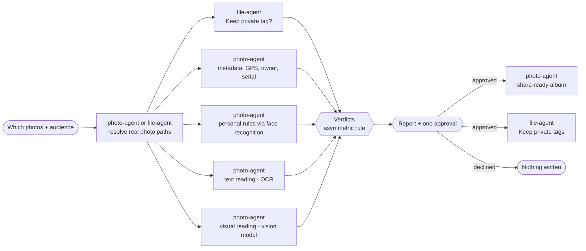

# Before You Share

**Your photos say more than you think. Before You Share reads them first, privately, on your NAS.**

An AI Skill for UGREEN AI NAS that checks photos before they are shared and tells you, per photo and for your chosen audience, what they give away: home location stored in the file, house numbers, license plates, boarding-pass codes, school crests, IDs and cards in the background, screens, notes with passwords and more. It then builds a share-ready album of only the cleared photos. The check uses the NAS's own photo index, text recognition, vision model and metadata, and makes no external calls, because asking a cloud AI to check private photos would itself be the leak.

Built for the [UGREEN Hackathon 2026 on AI NAS](https://ugreenhackathon.devpost.com/) · Track: Open Innovation

[Interactive simulation](https://karaaliosman.github.io/before-you-share/) · [Skill package (ZIP)](dist/before-you-share.zip) · [Proposal (PDF)](submission/proposal.pdf) · [SKILL.md](skill/before-you-share/SKILL.md)

| Official UGOS Skill checker | Package | Experts used | External calls |
| --- | --- | --- | --- |
| `static-pass` · 0 errors · 0 warnings (catalog 2.0.0) | 6 Markdown files, no scripts | photo, file, knowledge | none |

## Why it matters

- About **3 in 4** parents share content about their children online; among those who share, **21 to 23%** post content with a location tagged and **15%** in Ireland show the school name or uniform ([DPC and CNIL, Sharenting Research, 2026](https://www.dataprotection.ie/sites/default/files/uploads/2026-06/DPC-CNIL-Sharenting-Research-Final.pdf)).
- By age 13, parents have posted about **1,300** photos and videos of their child ([Children's Commissioner for England, 2018](https://assets.childrenscommissioner.gov.uk/wpuploads/2018/11/who-knows-what-about-me-infographic.pdf)).
- The US recorded **1,135,291** identity theft reports in 2024 ([FTC Consumer Sentinel Data Book 2024](https://www.ftc.gov/system/files/ftc_gov/pdf/csn-annual-data-book-2024.pdf)).
- Leaks hide in what the image shows, not only in its metadata: a posted boarding-pass barcode exposed the traveler's booking ([KrebsOnSecurity, 2015](https://krebsonsecurity.com/2015/10/whats-in-a-boarding-pass-barcode-a-lot/)); researchers copied house keys from photos taken about 60 m away ([UC San Diego, 2008](https://jacobsschool.ucsd.edu/news/release/791)); police advise parents not to post school uniforms, name tags or house numbers ([Australian Federal Police, 2023](https://afp.gov.au/news-centre/media-release/advice-parents-sharing-back-school-images-online)).
- **81%** of Americans familiar with AI expect companies' use of it to put their personal information to uses they are uncomfortable with ([Pew Research Center, 2023](https://www.pewresearch.org/short-reads/2023/10/18/key-findings-about-americans-and-data-privacy/)), which is why the check runs on the NAS.

Phone share sheets can strip metadata, and some phones blur IDs photo by photo, but none audits a whole library and the albums already shared, privately, on the family's own storage.

## What it does

| Mode | Example | Result | Writes |
| --- | --- | --- | --- |
| **Check before sharing** | "Check the beach photos before I post them publicly" | A verdict per photo (Clear, Fix first, Check this, Keep private) with the type, position and fix of every finding | After one approval: a share-ready album and Keep private tags |
| **Shared-album audit** | "What do my shared albums give away?" | The same check on albums you already shared, grouped by album, with the official steps to fix them | After approval: Keep private tags only |

**Fourteen risk types**, each with a severity per audience ([verdict rules](skill/before-you-share/references/verdict-rules.md)):

| Code | Risk | Private | Public | Marketplace |
| --- | --- | --- | --- | --- |
| LOC | GPS location stored in the file | Info | Amber | Amber |
| ADR | House number or readable postal address | Info | Red | Red |
| PLT | Readable license plate | Info | Amber | Amber |
| IDD | Identity document or ID card | Amber | Red | Red |
| PAY | Bank or payment card | Red | Red | Red |
| TKT | Boarding pass, ticket, barcode or QR code | Amber | Red | Red |
| MAL | Mail or package label with a name or address | Info | Red | Red |
| SCR | Screen with messages, email, accounts or codes | Amber | Red | Red |
| COD | Note with a password, Wi-Fi key, PIN or code | Red | Red | Red |
| KEY | House or car keys clearly visible | Info | Amber | Amber |
| SCH | School name, crest or name label on clothing or a bag | Info | Red | Red |
| MED | Prescription label or medical wristband | Amber | Red | Red |
| FAC | Faces of bystanders in the background | Info | Amber | Amber |
| MET | Owner, copyright or camera serial metadata | Info | Info | Amber |

Plus **personal rules**, for example "never show Mia's face publicly", checked with the NAS's own face recognition, so no face ever leaves the house to be matched.

## How it works



- **Asymmetric by design.** One reading is enough to raise a concern. A photo is Clear only when the text reading, the visual reading and the metadata all completed and found nothing that matters for the audience. Text and visual readings are separate delegations, so they cannot copy each other.
- **No content echo.** Experts are asked for the type and position of a finding, never for the number, code, name, address or coordinates. Nothing secret is written to chat, album names or tags; payment cards are reported only as "payment card visible".
- **Real results only.** Every delegation is self-contained and receives only verified upstream results (real file paths, never internal IDs) through named slots. Empty and partial results are reported, never filled in.
- **Sized for local models.** 20 photos per run by default (40 on request), both readings in batches of 5 with verdicts per batch, and the GPS result shown first.
- **Memory that respects the audience.** Keep private tags settle those photos at once in later public checks, while a family check still reads them normally.
- **Every state handled.** `completed`, `failed`, `cancelled`, `waiting_user` and `waiting_approval`, plus partial and empty results.

## Trust by design

- The Skill makes no external calls and sends nothing outside the NAS.
- Read-only until the user approves one consolidated plan; the NAS then asks its own approval for each write.
- Photos are never edited, moved, deleted or shared, and album sharing, permissions and metadata are never changed. Fixes are suggestions, with official UGOS steps on request.
- Only the user's own photos and albums the user shared are checked; albums other people shared are never analyzed.
- Honest limits: a second look, not a guarantee. Tiny text, reflections and context only a person would recognize can slip through, and the report says so.

Full rules: [privacy and safety](skill/before-you-share/references/privacy-and-safety.md).

## Repository layout

| Path | Contents |
| --- | --- |
| [`skill/before-you-share/`](skill/before-you-share/) | The Skill package: `SKILL.md` plus five references (the only content that goes into the ZIP) |
| [`dist/`](dist/) | Built ZIP and the official checker result |
| [`submission/`](submission/) | Round 1 proposal (Markdown source, HTML, PDF), Devpost story and submission checklist |
| [`tests/specimens/`](tests/specimens/) | Generator, manifest and 22 fictional SPECIMEN photos for the testing day |
| [`docs/`](docs/) | Interactive simulation site (GitHub Pages), video script, how the idea was chosen |
| [`tools/`](tools/) | Zero-dependency build script and proposal renderer |

## Build and check

Requirements: Node.js 20 or later, Python 3 with Pillow (specimens) and Markdown (proposal).

Download the official UGOS Skill Creation Tool from the [Hackathon Starter Kit](https://ai.ugreen.com/pages/hackathon-starter-kit) and extract it anywhere (it is not redistributed here). Then:

```bash
node tools/build.mjs --kit path/to/uliya-skill-kit --strict
```

This runs a local preflight (only `SKILL.md` and `references/*.md`, size and count limits, every reference linked), runs the official checker, writes `dist/check-result.json` and packages `dist/before-you-share.zip`. `--strict` fails on any warning.

```bash
python tools/make_proposal.py
```

This checks the ten answers against the 500-word limit and renders `submission/proposal.pdf` (under 1 MB) with a local Chrome or Edge.

```bash
python tests/specimens/generate.py
```

This regenerates the fictional specimen photos with their EXIF data.

## Install on a UGREEN AI NAS

Upload `dist/before-you-share.zip` through [SkillHub](https://skills.ugreen.com/skill-hub/publish) or the assistant's Skill installation flow, then ask: "Check the Beach day album before I post it publicly." To remove it, uninstall the Skill; the Keep private tag and any share-ready albums remain as ordinary tags and albums the owner can delete.

## Validation

The [validation plan](skill/before-you-share/references/validation-plan.md) defines five core and six edge cases on two fictional sets: the 12-photo Beach day album (expected for Public: 6 Clear, 2 Fix first, 1 Check this, 3 Keep private; for Private: 11 Clear, 1 Fix first) and a 10-photo Hazard set with one risk type per photo.

## How the idea was chosen

We first built a family emergency-document binder, then found about ten near-identical public projects from other entrants and pivoted to an uncovered problem. The full analysis, scoring and review changes are in [docs/idea-selection.md](docs/idea-selection.md).

## Disclosures

No third-party code, libraries, models or datasets are included in the Skill. AI tools: Claude (Anthropic) via Claude Code for research, drafting and review; the UGOS Skill Creation Tool for capability lookup and static checks. See [disclosures](skill/before-you-share/references/disclosures.md).

Not an official UGREEN product. UGREEN, UGOS and related names belong to their owners.

## License

Copyright © 2026 Ali Osman Kara (KaraAliOsman). All rights reserved during the hackathon judging period; see [LICENSE](LICENSE).
