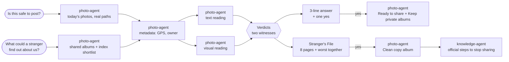

# Clueproof

**Every photo leaves clues. Clueproof finds them first, privately, on your NAS.**

One photo shows a house number. Another shows a school crest. A third has a boarding pass on the table, and a fourth carries the GPS position of where it was taken. Each looks harmless. Together they tell a stranger where a family lives, where the children study and when the house is empty.

Clueproof is an AI Skill for UGREEN AI NAS that reads your photos the way a stranger would, with the NAS's own text recognition, vision model, face recognition and metadata, and fixes what it finds with one yes. It makes no external calls of its own: checking private photos with a cloud AI would upload exactly what should stay private.

Built for the [UGREEN Hackathon 2026 on AI NAS](https://ugreenhackathon.devpost.com/) · Track: Open Innovation

[Interactive demo](https://karaaliosman.github.io/clueproof/) · [Launch film](docs/launch-film/) · [Skill package (ZIP)](dist/clueproof.zip) · [Proposal (PDF)](submission/proposal.pdf) · [SKILL.md](skill/clueproof/SKILL.md)

| Official UGOS Skill checker | Package | Experts used | External calls |
| --- | --- | --- | --- |
| `static-pass` · 0 errors · 0 warnings (catalog 2.0.0) | 7 Markdown files, no scripts | photo, file, knowledge | none of its own |

## Two sentences, no setup

### "Is this safe to post?"

No album to pick, no settings: Clueproof takes today's photos, assumes a public audience and says so in one line. Each photo is read twice, by text recognition and by the vision model, and the answer comes back in three lines:

```text
6 of 12 photos are ready to post (S01 still carries GPS location: post it through an app that removes location).
4 give clues away: house number (S05), boarding pass (S07), school crest (S08), address label (S10). 2 need a fix: license plate (S06), keys (S11).
Nothing was skipped.
Put the 6 ready photos in a ready-to-share album and keep the 4 risky ones in a private Keep private album?
```

One yes creates both albums (the NAS asks its own approval for each write). Next time, photos in Keep private are flagged instantly.

### "What could a stranger find out about us?"

Clueproof reads the albums you have shared and fills the **Stranger's File**: eight pages a stranger would try to fill.

| Page | Filled by |
| --- | --- |
| 1 Where you live | house numbers, address labels |
| 2 Your children | school crests and name labels, personal rules for a named child |
| 3 Your car | license plates |
| 4 Where you go | GPS location, boarding passes and tickets |
| 5 Who you are | ID and payment cards, your name stored in files |
| 6 How to get in | keys, passwords, codes, open accounts |
| 7 Your health | prescription labels |
| 8 Other people | bystanders, personal rules for other named people |

```text
A stranger could fill 5 of 8 pages about your family from Summer 2025 (all 12 photos read).
Worst together: where your children live and study (S05, S08), and where you live and how to get in (S05, S11).
Filled: Where you live (S05, S10) · Your children (S08) · Your car (S06) · Where you go (S01, S07) · How to get in (S11).
Make a clean copy of Summer 2025 with the 5 photos that fill no page, to share instead, and show how to stop sharing the old one?
```

The **mosaic effect** (photos that are harmless alone and revealing together) is what no per-photo tool shows. Clueproof shows it, and turns it into a clean album to share instead.

## Why it matters

- About **3 in 4** parents share content about their children online; among those who share, **21 to 23%** post content with a location tagged ([DPC and CNIL, Sharenting Research, 2026](https://www.dataprotection.ie/sites/default/files/uploads/2026-06/DPC-CNIL-Sharenting-Research-Final.pdf)).
- By age 13, parents have posted about **1,300** photos and videos of their child ([Children's Commissioner for England, 2018](https://assets.childrenscommissioner.gov.uk/wpuploads/2018/11/who-knows-what-about-me-infographic.pdf)).
- The US recorded **1,135,291** identity theft reports in 2024 ([FTC Consumer Sentinel Data Book 2024](https://www.ftc.gov/system/files/ftc_gov/pdf/csn-annual-data-book-2024.pdf)).
- Clues hide in what the image shows: a posted boarding-pass barcode exposed a traveler's booking ([KrebsOnSecurity, 2015](https://krebsonsecurity.com/2015/10/whats-in-a-boarding-pass-barcode-a-lot/)); researchers copied house keys from photos taken about 60 m away ([UC San Diego, 2008](https://jacobsschool.ucsd.edu/news/release/791)); police advise parents not to post school uniforms, name tags or house numbers ([Australian Federal Police, 2023](https://afp.gov.au/news-centre/media-release/advice-parents-sharing-back-school-images-online)).

Phone share sheets strip metadata, and some phones blur IDs one photo at a time. None of them reads a whole shared album the way a stranger would, privately, on the family's own storage.

## How it works



- **Two witnesses.** Text reading and visual reading are separate delegations. One reading is enough to raise a concern; a photo is Clear only when both readings and the metadata complete clean ([verdict rules](skill/clueproof/references/verdict-rules.md)).
- **Never repeats a value.** Experts report the type and position of a clue ("house number, top right"), never the number, code, name, address or coordinates.
- **Audience-aware.** The same house number is fine for the family chat and a clue in a public post; fourteen clue types have a severity for Private, Public and Marketplace.
- **Personal rules with local face recognition.** "Never show Mia's face publicly" is checked against the NAS's own people index; no face leaves the house to be matched.
- **Location only.** Photos whose only clue is stored GPS still go into the ready-to-share album, with one note, so real phone photos are not all flagged.
- **Sized for local models.** 20 photos per run, readings in batches of 5 with a progress line, the GPS count first.
- **Every state handled.** `completed`, `failed`, `cancelled`, `waiting_user`, `waiting_approval`, plus empty and partial results.

## Trust by design

- No external calls of its own; every photo is analyzed by the NAS's own experts and local models.
- Read-only until one yes; the NAS then asks its own approval for each write. Clueproof only creates the albums it is asked to create, never shares them, and never moves, edits, deletes or shares a photo.
- Only your own photos and the albums you shared; albums other people shared with you are never analyzed.
- Honest limits: a second look, not a guarantee. Tiny text and reflections can slip through, and the answer says when anything was not fully checked.

Full rules: [privacy and safety](skill/clueproof/references/privacy-and-safety.md).

## Repository layout

| Path | Contents |
| --- | --- |
| [`skill/clueproof/`](skill/clueproof/) | The Skill package: `SKILL.md` plus six references (the only content that goes into the ZIP) |
| [`dist/`](dist/) | Built ZIP and the official checker result |
| [`submission/`](submission/) | Round 1 proposal (Markdown source, HTML, PDF), Devpost story and submission checklist |
| [`tests/photos/`](tests/photos/) | 20 real, freely licensed Wikimedia Commons test photos with [credits](tests/photos/CREDITS.md) and expected results |
| [`docs/`](docs/) | Interactive demo (GitHub Pages), [launch film](docs/launch-film/), how the idea was chosen |
| [`tools/`](tools/) | Zero-dependency build script and proposal renderer |

## Build and check

Requirements: Node.js 20 or later; Python 3 with Markdown for the proposal.

Download the official UGOS Skill Creation Tool from the [Hackathon Starter Kit](https://ai.ugreen.com/pages/hackathon-starter-kit) and extract it anywhere (it is not redistributed here). Then:

```bash
node tools/build.mjs --kit path/to/uliya-skill-kit --strict
```

This runs a local preflight (only `SKILL.md` and `references/*.md`, size and count limits, every reference linked), runs the official checker, writes `dist/check-result.json` and packages `dist/clueproof.zip`.

```bash
python tools/make_proposal.py
```

This checks the ten answers against the 500-word limit and renders `submission/proposal.pdf` with a local Chrome or Edge.

## Install on a UGREEN AI NAS

Upload `dist/clueproof.zip` through [SkillHub](https://skills.ugreen.com/skill-hub/publish) or the assistant's Skill installation flow, then ask: "Is this safe to post?" To remove it, uninstall the Skill; any albums it created stay as ordinary albums you can delete.

## Validation

The [validation plan](skill/clueproof/references/validation-plan.md) defines six core and nine edge cases on two real photo sets: the 12-photo Summer 2025 album and an 8-photo Hazard set. Expected: "6 ready, 4 clues, 2 fixes" for a public post, "11 ready, 1 fix" for the family, and "5 of 8 pages" in the Stranger's File, dropping to 0 of 8 after the clean copy replaces the shared album.

## How the idea was chosen

We first built a family emergency-document binder, found about ten near-identical public projects from other entrants, and pivoted to the uncovered problem of what photos give away. Two red-team reviews then shaped the current design. Details: [docs/idea-selection.md](docs/idea-selection.md).

## Credits and disclosures

Test photos: Wikimedia Commons contributors under CC0, public domain and CC BY licenses, listed in [tests/photos/CREDITS.md](tests/photos/CREDITS.md); in the public demo, real people's identifiers are pixelated. Music in the launch film: see [docs/launch-film/CREDITS.md](docs/launch-film/CREDITS.md); its narration voice was generated by the team with ElevenLabs. No third-party code, libraries, models or datasets are in the Skill. AI tools: Claude (Anthropic) via Claude Code for research, drafting and review; the UGOS Skill Creation Tool for capability lookup and static checks. See [disclosures](skill/clueproof/references/disclosures.md).

Not an official UGREEN product. UGREEN, UGOS and related names belong to their owners.

## License

Copyright © 2026 Ali Osman Kara (KaraAliOsman). All rights reserved during the hackathon judging period; see [LICENSE](LICENSE). Test photos keep their original licenses.
